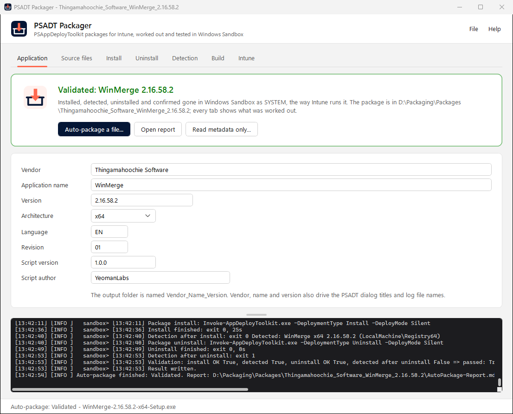
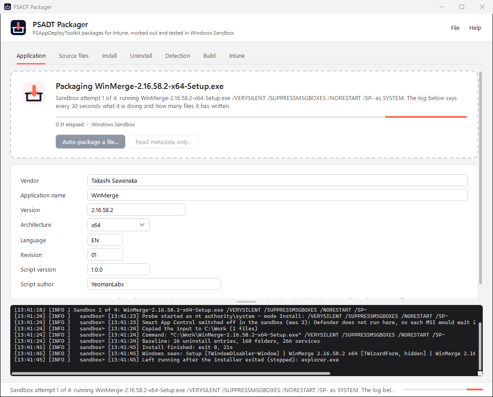
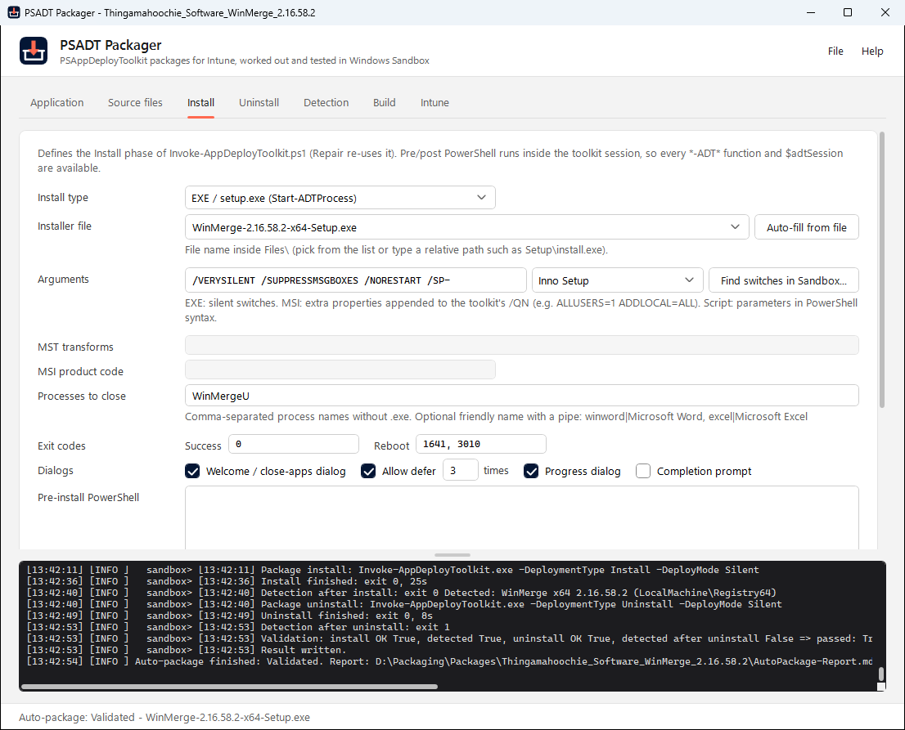
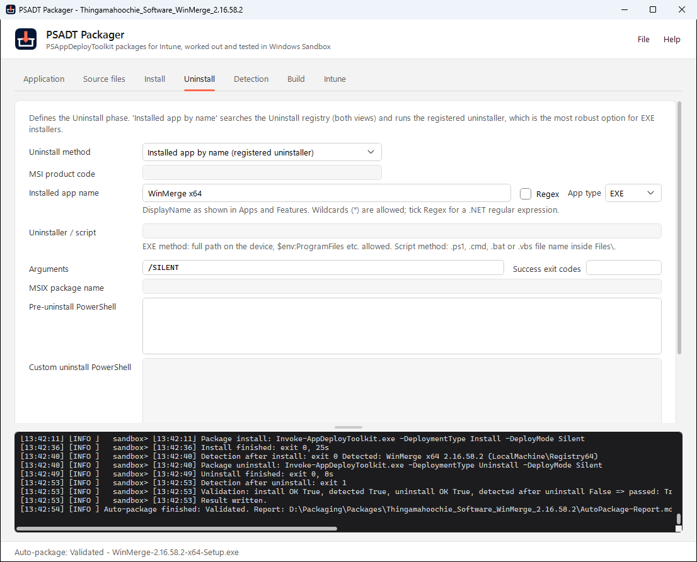
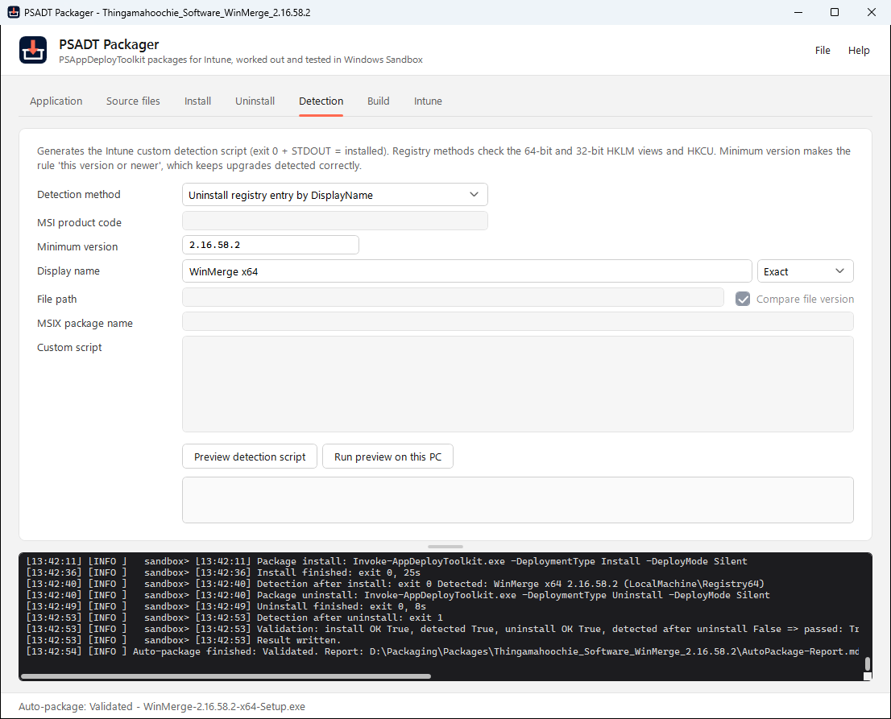
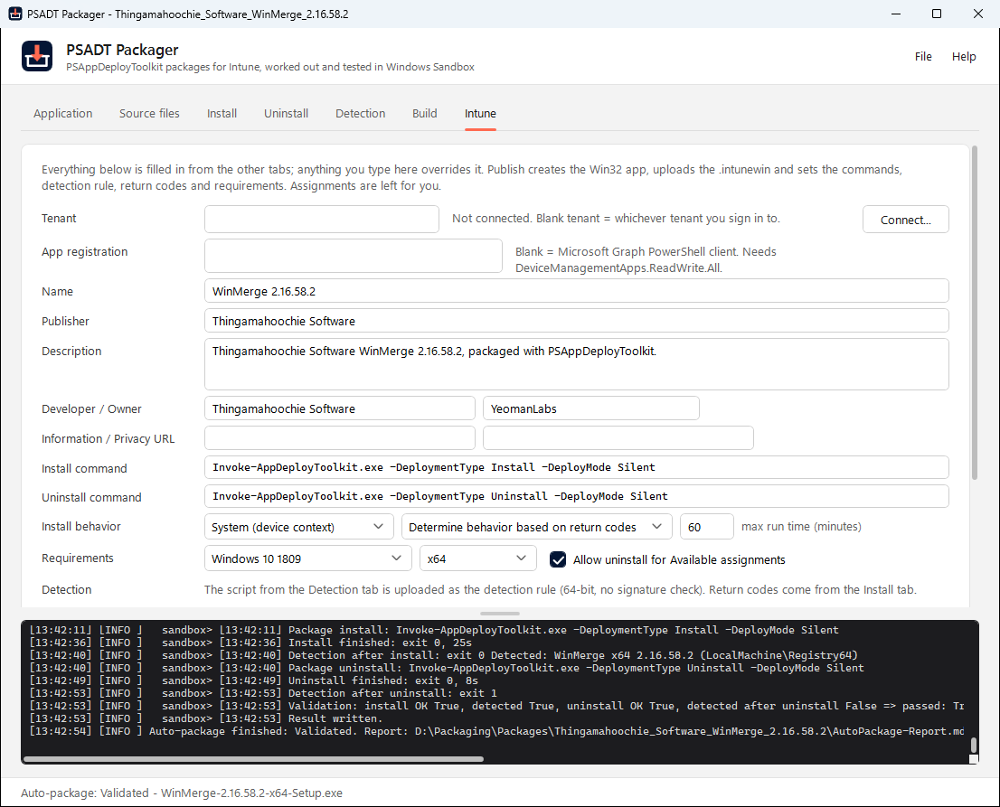

# PSADT Packager

[](https://github.com/YeomanLabs/psadt-packager/releases/latest)
[](LICENSE)

Drop in an installer, script, zip or folder and get a tested [PSAppDeployToolkit v4](https://psappdeploytoolkit.com) package for Intune.

PSADT Packager runs the installer in Windows Sandbox as SYSTEM, the way Intune does. From what it sees, it works out the silent switches, the uninstall and the detection rule, then builds the package and the `.intunewin`. Before calling it done, it installs, detects, uninstalls and detects the finished package again in a fresh sandbox. Most packages take one to two minutes.



- **Anything in.** `.msi`, `.exe`, `.msix`/`.appx`, `.ps1`, `.cmd`, `.bat`, `.vbs`, `.zip` or a folder.
- **Proven, not guessed.** The switches, uninstall command and detection rule come from what the installer actually did in the sandbox, and the finished package is tested end to end.
- **The same output every time.** A standard PSADT v4 package, an Intune detection script, the Win32 app settings, and optional one-click publishing to Intune.
- **One file.** Everything is `PsadtPackager.ps1` (WPF GUI and headless) and runs on Windows PowerShell 5.1 or PowerShell 7. The MSI adds a launcher and a Start menu entry.

## Get it

Download **`PSADT-Packager-<version>-x64.msi`** from the [latest release](https://github.com/YeomanLabs/psadt-packager/releases/latest) and run it, or install it silently:

```
msiexec /i PSADT-Packager-<version>-x64.msi /qn
```

- **Where it installs.** Per machine, to `C:\Program Files\PSADT Packager`, with a Start menu entry. New versions upgrade in place.
- **The launcher.** *PSADT Packager.exe* opens the GUI in Windows PowerShell 5.1 without a console window. Drop a file on it, or on its shortcut, to start packaging straight away.
- **What uninstalling leaves.** Each user's `%LOCALAPPDATA%\PsadtPackager` (settings, toolkit cache, sandbox run folders) stays behind.
- **SmartScreen.** The MSI and launcher aren't code-signed, so SmartScreen may warn the first time.

You can also run the script directly, without installing anything: `.\PsadtPackager.ps1`.

### Requirements

- **Windows Sandbox.** Needs Windows 10 or 11 Pro, Enterprise or Education with virtualization enabled.
  - **Turning it on.** Use *Windows Features*, or run this from an elevated **Windows PowerShell 5.1** prompt, then reboot: `Enable-WindowsOptionalFeature -Online -FeatureName Containers-DisposableClientVM`. In the Store build of PowerShell 7 the DISM cmdlets fail with "Class not registered".
  - **Without it.** Auto-package still builds from the file alone, but the switches, uninstall and detection are educated guesses.
- **Internet access the first time.** PSAppDeployToolkit comes from the PowerShell Gallery and IntuneWinAppUtil.exe from Microsoft's GitHub. An installed copy of the toolkit is used if you have one.

## Auto-package

Drop a file anywhere on the window, click *Auto-package a file...*, or drop it on the launcher.



| Input | Treated as |
| --- | --- |
| `.msi` | Windows Installer. Product code, version and architecture come from the MSI. `.mst` files next to it are applied as transforms. |
| `.exe` | Installer. The engine (Inno Setup, NSIS, InstallShield, WiX Burn, Omaha and others) is recognised and its silent switches are proven in the sandbox. |
| `.msix` / `.appx` (bundles too) | Provisioned for all users. |
| `.ps1`, `.cmd`, `.bat`, `.vbs` | Script install. Detection and uninstall are worked out from what the script creates. |
| Folder | Searched for the entry point, in this order: `install.*`/`setup.*` scripts, a single MSI, `setup.exe`, then any recognisable installer. An `uninstall.*` or `remove.*` script becomes the uninstall. A folder of program files with no installer is treated as a portable app. |
| `.zip` | Extracted, then treated like a folder. |

What happens:

1. **Read the file.** Name, vendor, version and architecture come from the MSI, the version resource, or the file or folder name. Versions, `(x64)` suffixes and e-mail or URL vendors are cleaned up.
2. **Run it in Windows Sandbox as SYSTEM**, one fresh sandbox per attempt.
   - For an EXE it tries the detected engine's switches first, then switches found as strings inside the binary, up to four sets. It stops at the first set that installs silently.
   - It records everything the install created: uninstall entries, folders, shortcuts, registry keys, services and scheduled tasks.
   - MSI and MSIX describe themselves, so they skip this step.
3. **Decide.**
   - **Detection** comes from the uninstall entry the installer registered. It tolerates version changes when the name carries the version. Without an entry, detection uses the main program file, a service or a registry key.
   - **Uninstall** runs the uninstall command the app registered, with the arguments that were proven in the same sandbox. The app is looked up by its exact registered name at uninstall time, so the command keeps working after the app updates itself. Without a registered uninstaller, it uses a shipped uninstall script, or generated clean-up of what the install created.
   - **Publisher and version** come from what the installer registered.
4. **Build** the package and the `.intunewin`.
5. **Test the package** in a fresh sandbox as SYSTEM: install, detect, uninstall, detect again. Anything left behind after the uninstall is listed.

The tabs fill in as soon as the file has been read, and again as the sandbox learns more. The card at the top shows the current step and an elapsed timer, then the result (green when validated) with *Open report*. The taskbar button shows progress too.

### How long it takes

These are measured end to end on Windows PowerShell 5.1: the sandbox test run, the build, and the package test in a fresh sandbox.

| Input | Type | Time |
| --- | --- | --- |
| VC++ 2015-2022 Redistributable | WiX Burn bundle with two MSIs | 67 s |
| 7-Zip | MSI | 53 s |
| WinMerge | Inno Setup | 96 s |
| Brave | Omaha stub that downloads the browser | 100 s |
| Contoso Widget (test fixture) | folder with `install.cmd` | 50 s |
| Fabrikam Agent (test fixture) | PowerShell script | 59 s |
| DemoTool (test fixture) | `.zip` of a portable app | 38 s |

Installers and scripts use two sandboxes, one to learn and one to test; MSI and MSIX packages need only the test. Starting a sandbox takes 5 to 30 seconds, depending on the PC.

Also packaged and validated: Genesys Cloud Background Assistant (WiX Burn bundle), Notepad++ (NSIS), the Brave standalone installer, and FieldKit (WiX MSI).

### The report

`AutoPackage-Report.md` is written next to every package. It shows each setting, how it was determined, every sandbox attempt, and the end-to-end result. The status is one of:

- **Validated**: all four steps of the package test passed.
- **Built**: the package was built but not tested end to end.
- **Needs attention**: no silent switches were found, the test failed, or the installer is per-user and lands in the SYSTEM profile.

### Watching it work

Every 30 seconds during an install, the log says what is running, whether it is busy, and how many files the install has written so far. A run that isn't moving is plain to see. These are real lines from two runs:

```
sandbox> Still running after 0:31 - explorer.exe; quiet for 6s; 337 new files, latest C:\Program Files\WinMerge\unins000.msg
sandbox> Still running after 1:02 - cmd.exe, conhost.exe, PING.EXE; quiet for 55s; no new files yet
```

## Inside the sandbox

### When a run counts as stuck

SYSTEM has no visible desktop, so an installer waiting for a click just sits there.

- **Stuck on a window.** The process tree, plus anything started since (such as the Windows Installer service), has been idle for 30 seconds while it shows a window with controls. During the package test the limit is 60 seconds.
- **Stuck without a window.** Idle for two minutes with no window.
- **Windows that don't count.** Quiet-mode windows that are created but never shown, and progress windows, meaning a visible progress bar like `/passive` installs and redistributables chained by a bundle show.
- **The report.** It quotes only the text the window actually shows.
- **Programs left running.** If the installer leaves something running (an app it launches at the end, or Explorer restarted), that program is stopped once it has been idle for 10 seconds.
- **Help text.** If the first switch set fails, the installer's own `/?` help text is captured for the report.

### Smart App Control is switched off inside the sandbox

Windows Sandbox starts with Smart App Control in evaluation mode, but with Microsoft Defender's engine disabled. So every MSI install asked Defender about the package, got no answer, and retried for two minutes before carrying on. This was traced with ETW: msiexec calls WLDP, then MpClient, then Defender's RPC endpoint, which doesn't exist in the sandbox.

The packager switches Smart App Control off in the throwaway sandbox before it runs anything, so an MSI installs in seconds. Real devices either run Defender, which answers at once, or have Smart App Control off, as managed devices do.

### Headless, or a hidden window

- **With `wsb.exe` (headless).** The Microsoft Store version of Windows Sandbox (Windows 11 24H2 and later) has a command-line tool, `wsb.exe`, and the packager drives it with no window at all. It finds `wsb.exe` on the PATH, in `%LOCALAPPDATA%\Microsoft\WindowsApps`, or in the Sandbox app's own folder.
- **Without `wsb.exe` (hidden window).** The built-in Windows Sandbox has no command-line tool, and managed PCs often block the Store update that adds one. The packager then starts Windows Sandbox from a `.wsb` file and hides its window and taskbar button as soon as they appear. The sandbox signs in, runs the test as SYSTEM through a scheduled task, and shuts itself down.
  - **Failed starts.** Windows Sandbox sometimes fails to start right after another one has closed. If a run hasn't started within three minutes, it is closed and retried once with the window shown, so any error is visible.
  - **Leftovers.** A hidden sandbox left behind by a packager that was closed mid-run is cleaned up on the next run.
- **Getting `wsb.exe`.** If your PC has no `wsb.exe` and can reach the Microsoft Store, opening Windows Sandbox once from the Start menu updates it.

Only one sandbox can run at a time.

## The tabs

Everything auto-package works out lands on the tabs, and you can fill them in yourself instead.

| | |
| --- | --- |
|  |  |
|  |  |

1. **Application.** *Auto-package a file...* does everything above. *Read metadata only...* reads the file (MSI, EXE, MSIX/AppX, PS1, CMD, BAT, VBS) and fills in the vendor, name, version, product code, silent switches, uninstall method and detection for you to finish by hand.
2. **Source files.** Add anything else the install needs: transforms, config files, extra installers. Folders can be copied as a subfolder or flattened.
3. **Install.**
   - Install type, arguments, transforms, processes to close, exit codes and dialogs.
   - Pre- and post-install PowerShell that runs inside the toolkit session.
   - *Find switches in Sandbox...* proves the arguments the same way auto-package does.
4. **Uninstall.** MSI product code, installed app by name, uninstaller EXE on the device, script, MSIX, custom or none.
   - **Name matching.** A name matches exactly unless it contains `*` (wildcard) or *Regex* is ticked. The toolkit's own default would also remove every app whose name merely contains it, so `Brave` would take `Brave Beta` with it.
   - **Success exit codes.** Codes that mean success, such as 19 from Chromium-based browsers, are ignored, so the package still exits 0 for Intune.
5. **Detection.** MSI product code, registry DisplayName (exact, wildcard or regex), file (optionally with version), MSIX, or a script of your own. *Run preview on this PC* runs the generated script locally.
6. **Build.**
   - Destination and the optional `.intunewin`.
   - The deploy mode used in the generated command lines:
     - **Silent** (default) never shows dialogs, for Required assignments.
     - **Auto** shows the toolkit's welcome, close-apps and progress dialogs when someone is signed in, for Available assignments with deferrals.
7. **Intune.** Sign in and publish. Every field is derived from the other tabs; type over anything you want to change.

`File > Save definition` writes the JSON so the package is reproducible. `Package.json` is also written next to every generated package.

## What you get

```
<Destination>\<Vendor>_<Name>_<Version>\
    Package\                      PSADT v4 toolkit + generated Invoke-AppDeployToolkit.ps1
        Files\                    installer, transforms, scripts
        SupportFiles\             anything else the deployment needs
    Detect-<Name>.ps1             Intune custom detection script
    Package.json                  the definition: reopen it to change anything and rebuild
    README.md                     Intune Win32 app settings for this package
    IntuneApp.json                the exact Win32 app body that gets posted to Graph
    AutoPackage-Report.md         auto-package only: what was decided, why, and what the sandbox proved
    Validation\                   auto-package only: toolkit logs from the end-to-end test
    Intune\<Vendor>_<Name>_<Version>.intunewin
```

### The generated deployment script

The generator writes only the `Variables` and `Functions` sections of `Invoke-AppDeployToolkit.ps1`. The header, parameter block and bootstrap come verbatim from the template `New-ADTTemplate` produces, so the file always matches the toolkit version it ships with.

| Install type | Generated call |
| --- | --- |
| MSI | `Start-ADTMsiProcess -Action Install -FilePath … [-Transforms …] [-AdditionalArgumentList …]` |
| EXE | `Start-ADTProcess -FilePath … -ArgumentList '…' -WindowStyle Hidden` |
| PowerShell script | `& "$($adtSession.DirFiles)\Install.ps1" <args>`, run in-process from the script's folder with full toolkit access. A failing exit code fails the deployment. |
| Batch / VBScript | `Start-ADTProcess` running `cmd.exe /c` or `cscript.exe //B` from the script's folder |
| MSIX / AppX | `Add-AppxProvisionedPackage -Online -PackagePath … -SkipLicense` |
| Custom | your code becomes the Install phase |

| Uninstall type | Generated code |
| --- | --- |
| MSI product code | `Start-ADTMsiProcess -Action Uninstall -ProductCode {…}` |
| Installed app by name (EXE) | `Get-ADTApplication -Name '…' -NameMatch Exact`, then the app's registered uninstall command (the quiet one if there is one) through `Start-ADTProcess` with the proven arguments. It runs from the Windows folder, because uninstallers that delete their own folder (Chromium's `setup.exe`) otherwise report failure. |
| Installed app by name (MSI or any) | `Uninstall-ADTApplication -Name '…' -NameMatch Exact` (or `Wildcard` / `Regex`) |
| Uninstaller EXE | `Start-ADTProcess` on the path on the device (`$env:ProgramFiles` etc. allowed), when the file exists |
| Script | the uninstall script from `Files\` |
| MSIX / AppX | removes the provisioned package and the installed copies for all users |
| Custom | your code becomes the Uninstall phase |

There are silent-switch presets for Inno Setup, NSIS, InstallShield, WiX Burn, Omaha / Google Update (Chrome, Brave, Edge: `/silent /install`), Squirrel, InstallAware, Advanced Installer, install4j, InstallBuilder, InstallAnywhere, Qt IFW, Wise, Setup Factory, and 7-Zip/WinRAR self-extractors. The engine is detected from the EXE where possible, and the log lists any known switches found as strings inside the binary.

### Detection scripts

The generated scripts follow the Intune contract: exit 0 and output on STDOUT means detected. Registry methods check HKLM 64-bit, HKLM 32-bit and HKCU. Version comparison treats `1.2.3` and `1.2.3.0` as equal, so a minimum-version rule means "this version or newer".

## Publishing to Intune

The Intune tab creates the Win32 app for you. Nothing is retyped; every setting comes from the definition you already filled in:

| Win32 app setting | Comes from |
| --- | --- |
| Name / App version | Application tab (`<Name> <Version>`) |
| Publisher, Developer, Owner | Application tab vendor and author |
| Install command | `Invoke-AppDeployToolkit.exe -DeploymentType Install -DeployMode <mode>` |
| Uninstall command | `Invoke-AppDeployToolkit.exe -DeploymentType Uninstall -DeployMode <mode>` |
| Setup file | `Invoke-AppDeployToolkit.exe` |
| Detection rule | the generated `Detect-<Name>.ps1`, uploaded as a 64-bit script rule |
| Return codes | Install tab success and reboot codes, plus 1618 and 60012 (retry) and 1602 (failed) |
| Requirements | Application tab architecture, plus the minimum OS you pick |
| Install behavior | System or user, restart behavior, maximum run time |

- **Overriding fields.** Anything you type into a field on the Intune tab overrides the derived value; *Reset to auto values* puts it back.
- **Seeing what gets sent.** *Preview app JSON* shows the exact body that will be sent, and the same body is written to `IntuneApp.json` beside every generated package.
- **Using the portal wizard instead.** The built `.intunewin` has its metadata name set to the app's display name, so *Name* and *Description* come in as `WinMerge 2.16.58.2` instead of `Invoke-AppDeployToolkit.exe`. That's the only field the wizard reads from a command-line `.intunewin`; the rest is in the package `README.md`.
- **Sign-in.** It uses the device code flow, so there are no modules to install. By default it signs in with the Microsoft Graph PowerShell public client, which needs `DeviceManagementApps.ReadWrite.All`. Point it at your own app registration if you'd rather scope it yourself.
- **What publishing does.** It creates the app and uploads the `.intunewin`. It always creates a new app; if one with the same name exists, you get a warning in the log, not an overwrite. **Assignments are deliberately left to you.**

## Command line

```powershell
# Auto-package an installer (CI, bulk packaging)
.\PsadtPackager.ps1 -InstallerPath C:\Sources\npp.8.9.8.1.Installer.x64.exe -NoGui -Destination C:\Packages

# Rebuild from a saved definition (for example after a toolkit update)
.\PsadtPackager.ps1 -Definition .\examples\GitHub-CLI.json -NoGui -Force

# Build and publish to Intune
.\PsadtPackager.ps1 -Definition .\Package.json -NoGui -Force -Publish -TenantId contoso.com
```

| Parameter | |
| --- | --- |
| `-InstallerPath` (`-Path`) | Auto-package this installer, script, `.zip` or folder. Without `-NoGui` the GUI opens and starts it. |
| `-Definition` | A `Package.json` to build (`-NoGui`) or open in the GUI. |
| `-NoGui` | Run headless. |
| `-Destination` | Output folder; overrides the definition. |
| `-Force` | Overwrite an existing package folder. |
| `-NoSandbox` | Auto-package from the file alone; nothing is run. |
| `-SkipValidation` | Skip the end-to-end package test. |
| `-Publish`, `-TenantId`, `-ClientId` | Create the Intune Win32 app after building. |

Headless exit codes: **0** built (and validated when a sandbox was available), **1** error, **2** built or attempted but needs attention (see `AutoPackage-Report.md`).

For scripting, call `PsadtPackager.ps1` in the install folder directly; the launcher doesn't wait or show output.

## Limits worth knowing

- **Per-user installers** (many Electron and Squirrel apps) install into the profile of whoever runs them. As SYSTEM, that's the system profile, so the report flags them. Look for the vendor's machine-wide installer (often an MSI), or deploy in the user context.
- **Installers that need a licence key, a server name or a reboot mid-way** can't be guessed. The report lists the switches it tried and the installer's own `/?` help text, so you can finish it on the Install tab.
- **Generated uninstalls** remove exactly what the sandbox saw being created. These are for scripts and installers that register no uninstaller. Review them before production use: the end-to-end test proves they run cleanly, not that nothing else needed removing.
- **VBScript installers (`.vbs`) can't be observed.** VBScript is an optional Windows component Microsoft is retiring, and the Windows Sandbox image doesn't include it (nor can it be added there). The report says so. Set detection and uninstall by hand, or better, convert the script to PowerShell.

## Troubleshooting

- **Status is *Needs attention*.** Open `AutoPackage-Report.md`. It lists every switch set tried and why each failed: a window it was waiting on and what that window said, an exit code, or nothing installed. It also includes the installer's `/?` help text. Enter the right switches on the Install tab and click *Find switches in Sandbox...*.
- **"Windows Sandbox is not installed".** Turn it on; see [Requirements](#requirements).
- **"Windows Sandbox is already open".** Only one sandbox can run at a time. Close it and try again.
- **Each run starts slowly, or retries "with its window shown".** That's the built-in Windows Sandbox without `wsb.exe`; see [Headless, or a hidden window](#headless-or-a-hidden-window).
- **Logs.**
  - **Sandbox runs.** Each sandbox run keeps its files under `%LOCALAPPDATA%\PsadtPackager\Sandbox\<date-time>\`: `config.json`, `probe.log` and `result.json`.
  - **The package test.** Its toolkit logs are copied to `Validation\` in the package folder.
- **Environment variables.**
  - `PSADT_PACKAGER_SANDBOX=Classic` uses the window mode even where `wsb.exe` exists.
  - `PSADT_PACKAGER_SANDBOX_WINDOW=Show` keeps the sandbox window visible.

## Notes

- **Keep destinations short** (for example `C:\Packages`). Windows PowerShell 5.1 can't copy the toolkit tree beyond MAX_PATH, and the build checks this up front.
- **Toolkit location.** The first build downloads PSAppDeployToolkit into `%LOCALAPPDATA%\PsadtPackager\Modules`. If you already have it installed, that copy is used. A copy in a OneDrive-synced Documents folder is copied into the cache once, because builds would otherwise wait for OneDrive to download it. Each package ships the exact toolkit version that generated it.
- **IntuneWinAppUtil.exe** is downloaded when needed. You can also point the Build tab at an existing copy.
- **Settings** (destination, tool path, author, tenant) persist in `%LOCALAPPDATA%\PsadtPackager\settings.json`. No tokens are written to disk; a sign-in lasts for the session.

## Building from source

| Path | Purpose |
| --- | --- |
| `PsadtPackager.ps1` | GUI, definition model, code generators, sandbox probe, auto-package, headless build |
| `examples\` | Sample definitions (edit the `Sources.Files` paths to match your share) |
| `installer\` | The MSI build: `Build-Installer.ps1`, the launcher (`Launcher.cs`) and the WiX package (`Package.wxs`) |
| `tests\Test-PsadtPackager.ps1` | Offline regression tests (no sandbox or network). They cover name and version clean-up, input classification, probe decisions, and generated uninstall code. They also check that every generated script parses and that the sandbox scripts parse and compile. Run them under both Windows PowerShell 5.1 and PowerShell 7. |
| `docs\screenshots\` | The pictures in this README |

`.\installer\Build-Installer.ps1` builds `dist\PSADT-Packager-<version>-x64.msi`. It needs the .NET SDK; WiX 5.0.2 comes from NuGet.

## License

[MIT](LICENSE).

- **PSAppDeployToolkit** is a separate project under its own license. PSADT Packager downloads it from the PowerShell Gallery and doesn't include it.
- **IntuneWinAppUtil.exe** is Microsoft's and is downloaded from Microsoft.
- **Affiliation.** This project isn't affiliated with the PSAppDeployToolkit team or Microsoft.
